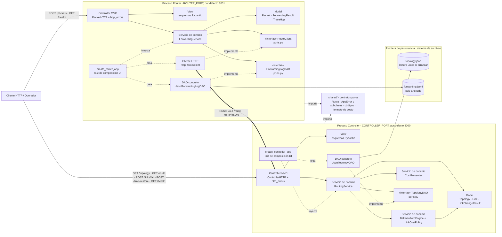
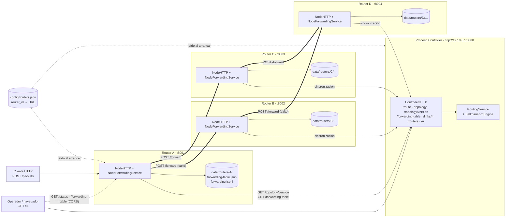
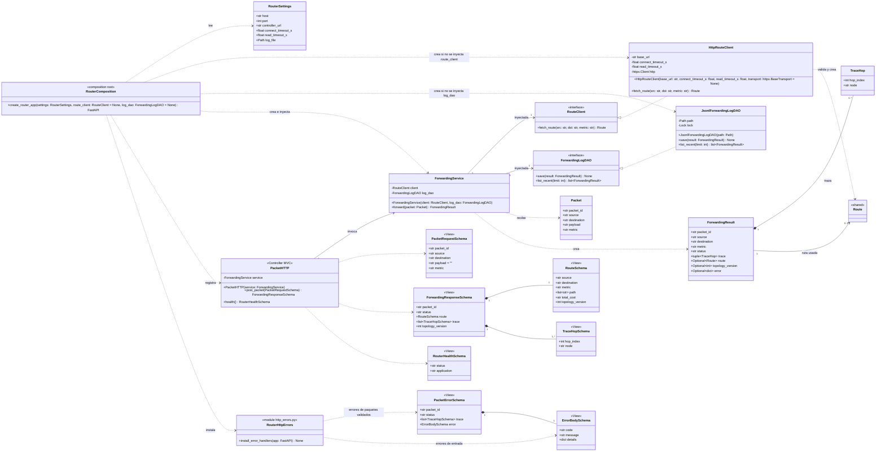
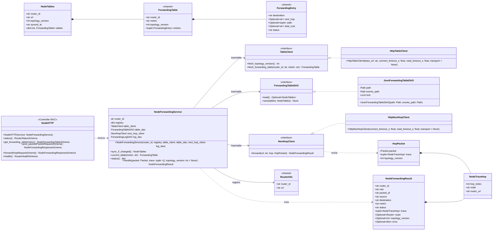

# 02 — Arquitectura estática: componentes, clases, MVC, DAO e inyección de dependencias

| Campo | Valor |
|---|---|
| Versión | **1.1** (borrador con C-32, aprobado por ambas el 31/10/2026; candidata a `spec-1.1`) · 2026-10-31 |
| Estado de aprobación | Ver `REVIEW-AND-BASELINE.md` |
| Trazabilidad | FR-01–FR-14, NFR-01–NFR-12, DEC-01–DEC-12 (`01`) · secuencias en `03` · contrato en `04` |

## 1. Reglas arquitectónicas vinculantes

1. **Dos procesos independientes.** `controller` (plano de control) y `router` (plano de datos simulado) se ejecutan como procesos separados del sistema operativo, sin memoria, DAO ni archivos de estado compartidos. Solo se comunican por HTTP/JSON.
2. **Solo el Controller calcula rutas.** El Router no importa NetworkX ni código del Controller. En modo legado obtiene cada ruta con `GET /route` (DEC-06); en modo nodo (C-32) recibe su tabla de forwarding con `GET /forwarding-table` y solo la consulta (DEC-10). Ningún módulo de `router/` contiene un algoritmo de caminos mínimos.
7. **Una instancia Router por nodo (C-32).** En modo nodo se ejecuta la **misma** aplicación `router` una vez por nodo de la topología, cada una con su `router_id`, su URL del registro `ROUTERS_FILE` y su directorio `data/routers/<router_id>/`; no comparten memoria ni archivos y se comunican solo por HTTP.
3. **MVC en ambas aplicaciones** (PDF p. 2): **Model** = objetos de dominio (`Topology`, `Link`, `Route`, `Packet`, `ForwardingResult`); **View** = esquemas Pydantic de entrada y salida HTTP; **Controller MVC** = clases `*HTTP` con los handlers FastAPI, que solo validan, delegan en servicios y serializan. La lógica de negocio vive en **servicios de dominio**. Aquí «Controller» como aplicación no se confunde con el controlador HTTP de MVC.
4. **DAO en ambas aplicaciones:** `TopologyDAO` encapsula la obtención y el estado de la topología; `ForwardingLogDAO` encapsula el almacenamiento y la consulta de resultados de reenvío.
5. **Regla de diseño (PDF p. 2):** ni los controladores HTTP ni los servicios abren archivos ni conocen implementaciones concretas de DAO; los servicios dependen de **interfaces** (módulos `ports.py`) recibidas por **inyección de dependencias** en su constructor. Las implementaciones concretas solo se crean en la raíz de composición (`create_controller_app`, `create_router_app`).
6. **Semántica HTTP solo en los adaptadores.** Las excepciones de dominio llevan un código (`error.code`) pero no un estado HTTP; la correspondencia código → estado vive únicamente en `controller/http_errors.py` y `router/http_errors.py`.

## 2. Diagrama de componentes



**Lectura del diagrama.** Las flechas continuas son dependencias de llamada; las punteadas, implementación, creación o importación. Solo los DAO concretos cruzan la **frontera de persistencia**: `JsonTopologyDAO` lee `topology.json` una vez al arrancar y conserva el estado mutable en memoria; `JsonlForwardingLogDAO` anexa una línea por resultado y las relee para consultas. `shared/` es un paquete instalable (o copiado de forma idéntica) en ambos procesos que solo contiene contratos de datos, excepciones y funciones puras, sin FastAPI, Pydantic, NetworkX, httpx ni estado.

### 2.1 Despliegue en modo nodo (C-32)

Diagrama fuente: `diagrams/02-5-despliegue-routers.mmd`. Cuatro instancias de la misma aplicación Router (una por nodo de F-20 o F-01) y el Controller; las flechas gruesas son reenvíos `POST /forward` reales entre procesos y las finas, la sincronización con el Controller.



## 3. Diagrama de clases

El modelo se presenta en tres vistas que muestran la **propiedad** de cada clase (PDF p. 4): Controller (Estudiante A), Router (Estudiante B) y contratos compartidos. `«interface»` marca los puertos inyectables. `Route` (módulo `shared/models.py`) se detalla en la vista Controller porque su propietaria es la Estudiante A; en la vista Router aparece como referencia `«shared»`. Las clases `«module»` representan módulos con funciones (adaptadores de errores), no clases instanciables. Los constructores usan la notación UML (nombre de la clase), que en Python corresponde a `__init__`; los parámetros con `= None` son opcionales. Los atributos privados que corresponden a dependencias (`dao`, `engine`, `presenter`, `client`, `log_dao`) se reciben por inyección; `policy`, `state` y `lock` son internos.

### 3.1 Vista Controller (propietaria: Estudiante A)

```mermaid
classDiagram
    direction TB
    class Link {
        +str source
        +str target
        +Decimal delay_ms
        +Decimal bandwidth_mbps
        +Decimal loss_probability
        +bool active
        +is_usable() bool
    }
    class Topology {
        +bool directed
        +int version
        +tuple~str~ nodes
        +tuple~Link~ links
        +has_node(node_id: str) bool
        +find_link(source: str, target: str) Link
    }
    class LinkChangeResult {
        +str source
        +str target
        +bool active
        +bool changed
        +int topology_version
    }
    class TopologyDAO {
        <<interface>>
        +get_topology() Topology
        +set_link_status(source: str, target: str, active: bool) LinkChangeResult
    }
    class JsonTopologyDAO {
        -Path path
        -Topology state
        -Lock lock
        +JsonTopologyDAO(path: Path)
        +get_topology() Topology
        +set_link_status(source: str, target: str, active: bool) LinkChangeResult
    }
    class TopologyLoadError {
        <<exception>>
        +str rule
        +str detail
    }
    class LinkCostPolicy {
        +weight(link: Link, metric: str) Fraction
    }
    class RouteLabel {
        +Fraction score
        +int hops
        +tuple~str~ path
    }
    class PathScore {
        +tuple~str~ path
        +Fraction score
    }
    class BellmanFordEngine {
        -LinkCostPolicy policy
        +BellmanFordEngine()
        +find_path(topology: Topology, src: str, dst: str, metric: str) PathScore
        +find_all_paths(topology: Topology, src: str, metric: str) dict~str, PathScore~
        +run_bellman_ford_on_weighted_graph(graph: nx.Graph, src: str, mode: str) dict~str, RouteLabel~
    }
    class CostPresenter {
        +format_cost(score: Fraction, metric: str) str
    }
    class RoutingService {
        -TopologyDAO dao
        -BellmanFordEngine engine
        -CostPresenter presenter
        +RoutingService(dao: TopologyDAO, engine: BellmanFordEngine, presenter: CostPresenter)
        +read_topology() Topology
        +compute_route(src: str, dst: str, metric: str) Route
        +set_link_status(source: str, target: str, active: bool) LinkChangeResult
        +topology_version() int
        +compute_forwarding_table(router_id: str, metric: str) ForwardingTable
    }
    class ControllerHTTP {
        <<Controller MVC>>
        -RoutingService service
        -tuple~RouterInfo~ routers
        +ControllerHTTP(service: RoutingService, routers: tuple~RouterInfo~ = ())
        +get_topology() TopologyResponseSchema
        +get_route(src: str, dst: str, metric: str) RouteResponseSchema
        +fail_link(LinkRequestSchema) LinkStatusSchema
        +restore_link(LinkRequestSchema) LinkStatusSchema
        +health() ControllerHealthSchema
        +get_topology_version() TopologyVersionSchema
        +get_forwarding_table(router_id: str, metric: str) ForwardingTableResponseSchema
        +list_routers() RouterListSchema
        +ui() HTMLResponse
    }
    class TopologyResponseSchema {
        <<View>>
        +int topology_version
        +bool directed
        +list~str~ nodes
        +list~LinkSchema~ links
    }
    class LinkSchema {
        <<View>>
        +str source
        +str target
        +Decimal delay_ms
        +Decimal bandwidth_mbps
        +Decimal loss_probability
        +bool active
    }
    class RouteResponseSchema {
        <<View>>
        +str source
        +str destination
        +str metric
        +list~str~ path
        +str total_cost
        +int topology_version
    }
    class LinkRequestSchema {
        <<View>>
        +str source
        +str target
    }
    class LinkStatusSchema {
        <<View>>
        +str source
        +str target
        +bool active
        +bool changed
        +int topology_version
    }
    class ControllerHealthSchema {
        <<View>>
        +str status
        +str application
    }
    class TopologyVersionSchema {
        <<View>>
        +int topology_version
    }
    class ForwardingEntrySchema {
        <<View>>
        +str destination
        +Optional~str~ next_hop
        +Optional~list~ path
        +Optional~str~ total_cost
        +str status
    }
    class ForwardingTableResponseSchema {
        <<View>>
        +str router_id
        +str metric
        +int topology_version
        +list~ForwardingEntrySchema~ entries
    }
    class RouterInfoSchema {
        <<View>>
        +str router_id
        +str url
    }
    class RouterListSchema {
        <<View>>
        +list~RouterInfoSchema~ routers
    }
    class ControllerSettings {
        +str host
        +int port
        +Path topology_file
        +tuple~RouterInfo~ routers
    }
    class ErrorBodySchema {
        <<View>>
        +str code
        +str message
        +dict details
    }
    class ControllerHttpErrors {
        <<module http_errors.py>>
        +install_error_handlers(app: FastAPI) None
    }
    class ControllerComposition {
        <<composition root>>
        +create_controller_app(settings: ControllerSettings, dao: TopologyDAO = None) FastAPI
    }
    class Route {
        <<shared, dataclass inmutable>>
        +str source
        +str destination
        +str metric
        +tuple~str~ path
        +str total_cost
        +int topology_version
    }
    class ForwardingTable {
        <<shared, dataclass inmutable>>
        +str router_id
        +str metric
        +int topology_version
        +tuple~ForwardingEntry~ entries
    }
    Topology "1" *-- "0..*" Link : contiene
    TopologyDAO <|.. JsonTopologyDAO
    JsonTopologyDAO "1" o-- "1" Topology : estado vigente
    JsonTopologyDAO ..> LinkChangeResult : devuelve
    JsonTopologyDAO ..> TopologyLoadError : lanza al cargar
    RoutingService "1" --> "1" TopologyDAO : inyectada
    RoutingService "1" --> "1" BellmanFordEngine : inyectado
    RoutingService "1" --> "1" CostPresenter : inyectado
    RoutingService ..> Route : crea
    RoutingService ..> ForwardingTable : crea
    BellmanFordEngine "1" *-- "1" LinkCostPolicy
    BellmanFordEngine ..> RouteLabel : usa
    BellmanFordEngine ..> PathScore : devuelve
    BellmanFordEngine ..> Topology : lee
    ControllerHTTP "1" --> "1" RoutingService : invoca
    ControllerHTTP ..> TopologyResponseSchema
    ControllerHTTP ..> RouteResponseSchema
    ControllerHTTP ..> LinkRequestSchema
    ControllerHTTP ..> LinkStatusSchema
    ControllerHTTP ..> ControllerHealthSchema
    ControllerHTTP ..> TopologyVersionSchema
    ControllerHTTP ..> ForwardingTableResponseSchema
    ControllerHTTP ..> RouterListSchema
    TopologyResponseSchema "1" *-- "0..*" LinkSchema
    ForwardingTableResponseSchema "1" *-- "0..*" ForwardingEntrySchema
    RouterListSchema "1" *-- "0..*" RouterInfoSchema
    ControllerComposition ..> ControllerSettings : lee
    ControllerComposition ..> JsonTopologyDAO : crea si no se inyecta dao
    ControllerComposition ..> RoutingService : crea e inyecta
    ControllerComposition ..> ControllerHTTP : registra
    ControllerComposition ..> ControllerHttpErrors : instala
    ControllerHttpErrors ..> ErrorBodySchema : serializa errores
```



### 3.2 Vista Router (propietaria: Estudiante B)



### 3.3 Vista de excepciones compartidas (`shared/errors.py`)

`Route` (`shared/models.py`) se detalla en §3.1. Esta vista muestra la jerarquía de excepciones de `shared/errors.py`.

```mermaid
classDiagram
    direction TB
    class AppError {
        <<exception>>
        +str code
        +str message
        +dict details
        +to_dict() dict
    }
    class InvalidRequestError {
        +code = "INVALID_REQUEST"
    }
    class NodeNotFoundError {
        +code = "NODE_NOT_FOUND"
    }
    class LinkNotFoundError {
        +code = "LINK_NOT_FOUND"
    }
    class RouteUnreachableError {
        +code = "ROUTE_UNREACHABLE"
    }
    class NegativeCycleError {
        +code = "NEGATIVE_CYCLE"
    }
    class LogPersistenceError {
        +code = "LOG_PERSISTENCE_ERROR"
    }
    class ControllerBadResponseError {
        +code = "CONTROLLER_BAD_RESPONSE"
    }
    class ControllerUnavailableError {
        +code = "CONTROLLER_UNAVAILABLE"
    }
    class ControllerTimeoutError {
        +code = "CONTROLLER_TIMEOUT"
    }
    AppError <|-- InvalidRequestError
    AppError <|-- NodeNotFoundError
    AppError <|-- LinkNotFoundError
    AppError <|-- RouteUnreachableError
    AppError <|-- NegativeCycleError
    AppError <|-- LogPersistenceError
    AppError <|-- ControllerBadResponseError
    AppError <|-- ControllerUnavailableError
    AppError <|-- ControllerTimeoutError
```



Además de estas clases, `shared/` contiene `error_contract.py` (constantes de `error.code` y nombres de campos JSON) y `cost_format.py` (función pura `is_canonical_cost(text: str) -> bool` que implementa la gramática de `01` §5.3). `MALFORMED_JSON` e `INTERNAL_ERROR` no son subclases de `AppError`: los generan los adaptadores HTTP (§9). `TopologyLoadError` pertenece al Controller y nunca se traduce a HTTP: aborta el arranque.

### 3.4 Vista Router en modo nodo (C-32; propietaria: Estudiante B)

Diagrama fuente: `diagrams/02-6-clases-router-nodo.mmd`. `RouterInfo`, `ForwardingEntry` y `ForwardingTable` viven en `shared/models.py` porque los producen el Controller y los validan los routers. `ForwardingLogDAO`, `Packet`, `Route` y los esquemas de error son los de §3.2. El modo legado (§3.2) no cambia.



**Controller (Estudiante A), clases y métodos nuevos:** `BellmanFordEngine.find_all_paths(topology, src, metric) -> dict[str, PathScore]`; `RoutingService.topology_version() -> int` y `RoutingService.compute_forwarding_table(router_id, metric) -> ForwardingTable`; `ControllerHTTP.get_topology_version()`, `get_forwarding_table(router_id, metric)`, `list_routers()` y `ui()`; esquemas `TopologyVersionSchema`, `ForwardingEntrySchema`, `ForwardingTableResponseSchema`, `RouterInfoSchema`, `RouterListSchema` (`controller/view.py`) y la página `DASHBOARD_HTML` (`controller/ui.py`, View). `ControllerSettings` añade `routers: tuple[RouterInfo, ...]` (vacío si no se configura `ROUTERS_FILE`), que `create_controller_app` pasa a `ControllerHTTP(service, routers=settings.routers)` *(aclaración C-32.6)*; los métodos nuevos de `BellmanFordEngine`, `RoutingService` y `ControllerHTTP`, los esquemas nuevos, `ForwardingTable` y `ControllerSettings.routers` figuran también en el diagrama de §3.1 *(aclaración C-32.11)*.

*Aclaraciones C-32 (01/11/2026):* `NodeTables` incluye `url` (la URL de la instancia que se guarda en `forwarding-table.json`, `04` §6) *(C-32.1)*; el constructor de `NodeForwardingService` recibe `next_hop_client` entre `table_dao` y `log_dao`, como muestra el diagrama *(C-32.3)*.

## 4. Correspondencia MVC/DAO y responsabilidades

| Capa | Controller (Estudiante A) | Router (Estudiante B) | Responsabilidad | Puede depender de |
|---|---|---|---|---|
| Model | `Topology`, `Link`, `LinkChangeResult` (`controller/models.py`); `Route` (`shared/models.py`) | `Packet`, `ForwardingResult`, `TraceHop` (`router/models.py`); `Route` | Objetos de dominio inmutables, sin E/S y **sin validación** (la validación de topologías la hace solo `JsonTopologyDAO`; así una prueba puede construir un `Topology` con pesos negativos, TC-11) | Biblioteca estándar |
| View | `TopologyResponseSchema`, `LinkSchema`, `RouteResponseSchema`, `LinkRequestSchema`, `LinkStatusSchema`, `ControllerHealthSchema`, `ErrorBodySchema` (`controller/view.py`) | `PacketRequestSchema`, `ForwardingResponseSchema`, `RouteSchema`, `TraceHopSchema`, `RouterHealthSchema`, `ErrorBodySchema`, `PacketErrorSchema` (`router/view.py`) | Esquemas Pydantic de entrada y salida HTTP (`extra="forbid"` en las entradas) | Pydantic, Model |
| Controller MVC | `ControllerHTTP` (`controller/http.py`) + `controller/http_errors.py` | `PacketHTTP` (`router/http.py`) + `router/http_errors.py` | Validar con View, invocar el servicio, serializar; traducir excepciones a HTTP | Servicio, View, FastAPI |
| Servicio de dominio | `RoutingService` (`service.py`), `BellmanFordEngine`, `LinkCostPolicy`, `RouteLabel`, `PathScore` (`engine.py`), `CostPresenter` (`presenter.py`) | `ForwardingService` (`service.py`) | Reglas de negocio: elegir rutas; construir trazas y registrar resultados | `ports.py`, Model, `shared`; NetworkX solo en `engine.py` |
| Puertos (interfaces) | `TopologyDAO` (`controller/ports.py`) | `RouteClient`, `ForwardingLogDAO` (`router/ports.py`) | Contratos abstractos que usan los servicios | Model, `shared` |
| DAO concreto | `JsonTopologyDAO`, `TopologyLoadError` (`controller/dao.py`) | `JsonlForwardingLogDAO` (`router/dao.py`) | Leer, validar y mantener la topología; anexar y releer resultados | `ports.py`, sistema de archivos |
| Cliente de comunicación | — | `HttpRouteClient` (`router/client.py`) | Obtener y validar la ruta por HTTP; normalizar errores de red | `ports.py`, httpx, `shared` |
| Composición | `create_controller_app` (`controller/app.py`) | `create_router_app` (`router/app.py`) | Leer configuración, crear implementaciones e inyectarlas | Todo su propio proceso y `shared` |
| Modo nodo *(C-32)* | `find_all_paths`, `compute_forwarding_table`, `/forwarding-table`, `/topology/version`, `/routers`, `/ui` (View `controller/ui.py`) | Model `NodeTables`, `NodeTraceHop`, `HopPacket`, `NodeForwardingResult`; View `RouterStatusSchema`, `NodeForwardingTableSchema`, `HopRequestSchema`, `NodeForwardingResponseSchema`; Controller MVC `NodeHTTP`; servicio `NodeForwardingService`; puertos `TableClient`, `NextHopClient`, `ForwardingTableDAO`; clientes `HttpTableClient`, `HttpNextHopClient`; DAO `JsonForwardingTableDAO` | Tabla de forwarding por router, sincronización por versión y reenvío salto a salto | Las mismas reglas de esta tabla y de §8 |

**`CostPresenter` y `Route.total_cost`.** `Route` no es un objeto interno del motor sino el contrato de datos que viaja al Router, y el contrato define `total_cost` como cadena canónica (`01` §5.3). Por eso `RoutingService` invoca `CostPresenter` antes de crear `Route`; la selección nunca usa ese campo, porque el motor trabaja solo con `PathScore`. Los `Settings` de cada proceso viven en `settings.py` (§8).

## 5. Contratos de métodos públicos

| Operación | Firma y comportamiento | Prohibido |
|---|---|---|
| `TopologyDAO.get_topology()` | `() -> Topology`: instantánea inmutable y consistente con su `version`. | Que un servicio lea el archivo JSON. |
| `TopologyDAO.set_link_status(source, target, active)` | `-> LinkChangeResult`; cambio atómico bajo `lock`; `version += 1` solo si `active` cambia; `NodeNotFoundError` si un extremo no existe; `LinkNotFoundError` si no hay enlace; en modo no dirigido `(A,B)` y `(B,A)` designan el mismo enlace. | Que un handler edite el estado. |
| `RoutingService.read_topology()` | `-> Topology` vía DAO (usado por `GET /topology`). | Acceso directo a archivos. |
| `RoutingService.compute_route(src, dst, metric)` | `-> Route`; valida `metric` (`InvalidRequestError`); pide **una** instantánea al DAO y comprueba en ella `src` y después `dst` (`NodeNotFoundError`); llama a `engine.find_path`; después llama **una vez** a `presenter.format_cost(score, metric)`; construye `Route(source=…, destination=…, metric=…, path=…, total_cost=…, topology_version=snapshot.version)` con argumentos nombrados. | Algoritmo en HTTP o DAO. |
| `RoutingService.set_link_status(source, target, active)` | `-> LinkChangeResult`; delega en el DAO. | Decidir rutas. |
| `BellmanFordEngine.find_path(topology, src, dst, metric)` | `-> PathScore(path, score)`: ruta simple y puntuación exacta (suma para `delay`/`inverse_bandwidth`, producto de supervivencia para `loss`); lanza `RouteUnreachableError` o `NegativeCycleError`; **no conoce** a `CostPresenter` ni produce JSON. Salvo el caso trivial `src == dst` (que devuelve `[src]` sin invocar el núcleo), siempre llama a `run_bellman_ford_on_weighted_graph`. | Ejecutarse en el Router. |
| `BellmanFordEngine.run_bellman_ford_on_weighted_graph(graph, src, mode)` | `mode ∈ {"additive", "product"}` → `dict[str, RouteLabel]`; núcleo común de relajación, desempate y detección de ciclo negativo en ambos modos (§6.2); `graph` es un `nx.Graph` o un `nx.DiGraph` (subclase de `nx.Graph`) con el peso de cada arco en el atributo `weight` (`Fraction`; en modo `product`, el factor `1 − p`). | Una rama de algoritmo exclusiva para pruebas. |
| `LinkCostPolicy.weight(link, metric)` | `-> Fraction`: `d`, `1/b` o factor `1 − p` (equivalente multiplicativo de `−ln(1−p)`). | Redondear antes de seleccionar. |
| `CostPresenter.format_cost(score, metric)` | `-> str` que cumple `is_canonical_cost` y la precisión de `01` §5.3 (§6.3). | Influir en la selección. |
| `HttpRouteClient.fetch_route(src, dst, metric)` | `-> Route`; un `GET /route` con timeouts de conexión y lectura; valida la respuesta (`04` §4.3) usando `shared.cost_format.is_canonical_cost`; convierte **todo** `httpx.TransportError` y toda respuesta no conforme en una de las excepciones de §9. El parámetro opcional `transport` permite inyectar `httpx.MockTransport` en pruebas. | Recalcular costos u optimalidad. |
| `ForwardingService.forward(packet)` | `-> ForwardingResult`; llama una vez a `client.fetch_route`; construye `trace` igual a `path`; llama una vez a `log_dao.save(result)` antes de devolver. Ante **cualquier** excepción del cliente guarda un resultado `failed` (con `error.code` de la excepción, o `INTERNAL_ERROR` si no es `AppError`) y relanza la misma excepción. Si `save` lanza cualquier excepción, la envuelve en `LogPersistenceError` (defensa adicional al contrato del DAO). | Acceder a archivos o calcular rutas. |
| `ForwardingLogDAO.save(result)` | `-> None` solo si la línea quedó escrita; los errores de E/S se convierten en `LogPersistenceError`. | Escribir desde un handler. |
| `ForwardingLogDAO.list_recent(limit)` | `-> list[ForwardingResult]`: los `limit` últimos resultados en orden de escritura (recuperación exigida por el PDF p. 2; usado por TC-06 y TC-16). | Exponerlo por HTTP (no hay endpoint). |
| `ControllerHTTP.*`, `PacketHTTP.*` | Reciben esquemas ya validados, invocan un método del servicio y devuelven esquemas de respuesta. | Leer archivos o ejecutar algoritmos. |
| `BellmanFordEngine.find_all_paths(topology, src, metric)` *(C-32)* | `-> dict[str, PathScore]` con la mejor ruta (DEC-08) de `src` a **cada** destino alcanzable, sin incluir `src`; **una sola** llamada a `run_bellman_ford_on_weighted_graph`; misma construcción de grafo que `find_path` (§6.1). | Una rama de algoritmo distinta de la de `find_path`. |
| `RoutingService.topology_version()` *(C-32)* | `-> int`: versión de una instantánea del DAO. | — |
| `RoutingService.compute_forwarding_table(router_id, metric)` *(C-32)* | `-> ForwardingTable`; valida `metric` (`InvalidRequestError`) y que `router_id` exista en **una** instantánea (`NodeNotFoundError`, `details.field = "router_id"`); llama una vez a `find_all_paths` y una vez a `format_cost` por destino alcanzable; una `ForwardingEntry` por cada otro nodo, en el orden de `nodes`: alcanzable → `next_hop = path[1]`, `status = "active"`; inalcanzable → `next_hop`, `path` y `total_cost` en `None`, `status = "unreachable"`. | Que el Router reciba rutas parciales o inventadas. |
| `NodeForwardingService.sync_if_changed()` *(C-32)* | `-> NodeTables`; llama a `table_client.fetch_topology_version()`; si coincide con la tabla guardada, no pide nada más (NFR-12); si no, pide las tres tablas, comprueba que `router_id` y `topology_version` coinciden y las guarda con `table_dao.save`. Errores del Controller → las excepciones de `HttpRouteClient` (§9). | Calcular o modificar filas. |
| `NodeForwardingService.handle(packet, trace=(), topology_version=None)` *(C-32)* | `-> NodeForwardingResult`; algoritmo de §6.4; registra un `NodeForwardingResult` por paquete procesado en este router con `log_dao.save` (rol `ingress`, `transit` o `egress`), tanto en el éxito como en el fallo, y relanza la excepción en los fallos (igual que `ForwardingService`). | Reenviar sin confirmar la versión vigente o a una URL que no esté en el registro. |
| `NextHopClient.forward(url, hop)` *(C-32)* | `-> NodeForwardingResult` del siguiente salto; un `POST {{url}}/forward`; `ConnectError` → `NextHopUnavailableError`, cualquier timeout → `NextHopTimeoutError`, respuesta no conforme → `NextHopBadResponseError`; un error con sobre válido y código de §9 se reproduce con la misma excepción. | Reintentar o elegir otro vecino. |
| `ForwardingTableDAO.save(tables)` / `load()` *(C-32)* | Guarda de forma atómica la instantánea en `forwarding-table.json` y anexa una línea a `table-events.jsonl` con la versión anterior, la nueva y las filas cambiadas; `load()` devuelve la última instantánea o `None`. Errores de E/S → `LogPersistenceError`. | Guardar estado de otro router. |
| `NodeHTTP.*` *(C-32)* | Igual que `PacketHTTP`: validan con la View, invocan un método de `NodeForwardingService` y serializan. | Consultar tablas o elegir vecinos en el handler. |

## 6. Diseño interno del motor de rutas y del presentador de costos

### 6.1 Construcción del grafo

`find_path` toma la instantánea `Topology`, descarta enlaces con `active=false` o `loss_probability=1` y crea un `nx.DiGraph` (dirigido) o `nx.Graph` (no dirigido, cuyos enlaces se recorren en ambos sentidos). Cada arco guarda su peso exacto en el atributo de arista **`weight`** (`graph[u][v]["weight"]`, de tipo `Fraction`), calculado por `LinkCostPolicy`: `d` o `1/b` en modo `additive`; `1 − p` en modo `product` (métrica `loss`). Si `src == dst`, devuelve directamente `PathScore((src,), 0)` en modo aditivo o `PathScore((src,), 1)` en modo producto, sin invocar el núcleo (la ruta vacía es óptima con pesos no negativos).

**Por qué no se usa directamente `nx.bellman_ford_path`:** devuelve una de las rutas de igual costo según el orden de iteración (no garantiza DEC-08) y no admite el modo producto exacto de `loss`. NetworkX se usa para representar el grafo y, en las pruebas, como oráculo independiente: `bellman_ford_path_length` para el costo de `delay` e `inverse_bandwidth`, y `bellman_ford_predecessor_and_distance` (que lanza `NetworkXUnbounded` solo si el ciclo negativo es alcanzable desde el origen) para TC-11.

### 6.2 Núcleo de relajación (especificación, no código)

```text
run_bellman_ford_on_weighted_graph(graph, src, mode):
    label[src] = RouteLabel(score = 0 si mode=="additive" si no 1, hops = 0, path = (src,))
    los demás nodos: sin etiqueta (inalcanzables)
    repetir |V| − 1 rondas síncronas:
        nuevo = copia(label)                      # solo se extienden etiquetas de la ronda anterior
        para cada arco u→v con label[u] definida (en cualquier orden):
            cand = extender(label[u], v, peso(u, v))   # suma o producto; hops + 1; path + (v,)
            si v sin etiqueta en nuevo o mejor(cand, nuevo[v]): nuevo[v] = cand
        si nuevo == label: salir                   # sin cambios
        label = nuevo
    para cada arco u→v con label[u] definida:          # pasada de detección, ambos modos
        si mejora_primaria(extender(label[u], v, peso(u, v)).score, label[v].score):
            lanzar NegativeCycleError
    devolver label

mejor(a, b) := clave(a) < clave(b), con clave = (score, hops, path) en modo additive
                                     y (−score, hops, path) en modo product
mejora_primaria(x, y) := x < y en modo additive;  x > y en modo product
```

- **Corrección.** Tras la ronda `k`, cada etiqueta es la mejor caminata de como máximo `k` arcos según `(costo, saltos, ruta)`: el orden se conserva al extender (se suma el mismo peso, o se multiplica por el mismo factor positivo, y se añade el mismo nodo final). Con pesos ≥ 0, o factores en (0, 1], todo ciclo empeora el costo o, si es neutro, aumenta los saltos; por tanto la óptima es una ruta simple de como máximo `|V| − 1` arcos, y las rondas terminan con la solución de DEC-08.
- **Ciclos negativos.** En la pasada final `label[v]` siempre está definida cuando lo está `label[u]`: todo nodo alcanzable tiene una ruta simple de como máximo `|V| − 1` arcos y queda etiquetado en las rondas (o antes, si se alcanza un punto fijo). La pasada compara **solo** la magnitud primaria y detecta un ciclo de mejora alcanzable desde `src`: en modo aditivo, de suma negativa; en modo producto, de producto > 1 (solo posible con factores > 1, es decir, `p < 0`, que la validación de topologías rechaza). Un ciclo en otra componente no se detecta porque sus nodos nunca reciben etiqueta.
- **Terminación y complejidad.** Como máximo `|V| − 1` rondas y una pasada de detección; los ciclos de costo cero no causan bucles. Por ronda se hacen `|E|` extensiones (cada una crea y compara rutas de longitud ≤ `|V|`: `O(|E|·|V|)`) más la copia y la comparación de las etiquetas (`O(|V|²)`); en total `O(|V|²·(|V| + |E|))` operaciones elementales. Como cada ronda solo lee etiquetas de la anterior y el orden `(costo, saltos, ruta)` es total, el resultado no depende del orden en que se recorran los arcos, por lo que no hace falta ordenarlos. Memoria `O(|V|² + |E|)`. Son cotas de operaciones abstractas: el costo de la aritmética `Fraction` crece con el tamaño de numeradores y denominadores.

### 6.3 Procedimiento de `CostPresenter.format_cost`

1. Contexto `decimal.localcontext()` con `prec = 60` y `rounding = ROUND_HALF_EVEN`; nunca se usa `float`.
2. `delay`, `inverse_bandwidth` (redondeo **exacto** del racional, sin división decimal intermedia): si `score = 0` → `"0"`; si no, se halla el exponente decimal `e` con `10^e ≤ score < 10^(e+1)` comparando `Fraction`, se calcula `m = round(score / 10^(e−11))` (la función `round` de Python redondea un `Fraction` de forma exacta y *half-even*) y el valor es `m · 10^(e−11)`; si `m = 10^12`, se reescribe como `10^(e+1)`.
3. `loss`: `S = score`; si `S = 1` → `"0"`. Con `q = 1 − S` exacto: si `0 < q ≤ 1/4`, costo = `Σ_{j=1..25} q^j / j` (sin formar `1 − Decimal(S)` redondeado, lo que evita la cancelación con `p = 1e-60`; el error relativo de truncamiento es ≤ `q^25 / (26(1 − q))` ≤ 4.6 × 10⁻¹⁷); si `q > 1/4`, costo = `−(Decimal(S.numerator) / Decimal(S.denominator)).ln()`.
4. Para `loss`, redondear el valor calculado a 12 cifras significativas (`ROUND_HALF_EVEN`). En todos los casos, escribir en el formato canónico de `01` §5.3: el resultado debe cumplir `is_canonical_cost` y, para `loss`, un error relativo ≤ 1 × 10⁻¹⁰ frente a una referencia de al menos 100 cifras (TC-38, TC-39).

### 6.4 Tablas de forwarding y reenvío salto a salto (C-32)

**Cálculo de la tabla (Controller).** `compute_forwarding_table(R, m)` ejecuta el núcleo de §6.2 **una vez** desde `R` y obtiene la etiqueta óptima de cada destino; con el orden total de DEC-08, si la mejor ruta de `R` a `D` es `R, X, …, D`, el tramo `X, …, D` es la mejor ruta de `X` a `D` (cualquier tramo mejor por `(costo, saltos, ruta)` daría una ruta mejor desde `R`, porque el prefijo es idéntico). Por eso el reenvío salto a salto, con cada router usando **su** tabla, recorre exactamente la ruta que devuelve `GET /route` para la misma versión (TC-46).

**Procesamiento de un paquete en el router `R`** (`handle`, ingreso con `trace = ()`; tránsito con la traza y la versión recibidas):

```text
1. si R aparece en trace                      → ForwardingLoopError (508)
2. tablas = sync_if_changed()                   # GET /topology/version en cada salto; tabla nueva solo si cambió
3. si len(trace) + 1 > número de nodos de la tabla vigente → HopLimitExceededError (508)
4. si topology_version recibida ≠ tablas.topology_version → TopologyChangedError (409)
5. trace = trace + (NodeTraceHop(len(trace), R, url(R)),)
6. si packet.destination == R                   → resultado forwarded (rol egress, o ingress si el origen es R)
7. fila = tabla[metric][destination]  (ausente → NodeNotFoundError; status unreachable → RouteUnreachableError)
8. resultado = next_hop_client.forward(url(fila.next_hop), HopPacket(packet, trace, versión))
9. comprobar: resultado.trace empieza por trace, termina en destination, sin repetidos y con la misma versión
   (si no → NextHopBadResponseError)
10. registrar y devolver resultado (rol ingress o transit)
```

*Aclaraciones C-32 (01/11/2026):* el límite de saltos se comprueba después de sincronizar, porque el número de nodos sale de la tabla vigente *(C-32.4)*. Un `InvalidRequestError` de ingreso (`source` ≠ `router_id`) se lanza antes de registrar nada y responde solo el sobre `{"error": …}`; todo otro fallo se registra con `trace = []` y recibe `details.at_router` = router donde se originó, salvo que ya lo traiga de un salto posterior *(C-32.7)*. En la respuesta de un `POST /forward`, `route.total_cost` es el costo desde el router que responde hasta el destino (`"0"` en el destino); cada router lo reemplaza por el de su propia fila, de modo que el router de ingreso devuelve el costo de toda la ruta *(C-32.8)*.

Los timeouts de conexión y lectura de `NextHopClient` son los de `CONTROLLER_CONNECT_TIMEOUT_SECONDS` y `CONTROLLER_READ_TIMEOUT_SECONDS`. Cada router espera la respuesta del siguiente, de modo que un salto que no responde produce 504 en el router que lo esperaba y ese error se propaga hacia el origen.

**Sincronización periódica.** En modo nodo, `create_router_app` arranca un hilo que llama a `sync_if_changed()` cada `TABLE_SYNC_INTERVAL_SECONDS` (0 lo desactiva; lo usan las pruebas que sincronizan a mano) y lo detiene al cerrar la aplicación. Un error de sincronización no borra la tabla guardada: se informa en `GET /status` (`sync_status = "error"`) y se reintenta.

## 7. Composición, inyección de dependencias y configuración (NFR-05, NFR-07)

`create_controller_app(settings, dao=None)` usa el `dao` recibido o, si no se pasa, crea `JsonTopologyDAO(settings.topology_file)`; crea `BellmanFordEngine()`, `CostPresenter()` y `RoutingService(dao=…, engine=…, presenter=…)`; registra `ControllerHTTP` y los manejadores de `controller/http_errors.py`. `create_router_app(settings, route_client=None, log_dao=None)` usa los dobles recibidos o crea `HttpRouteClient(…)` y `JsonlForwardingLogDAO(settings.log_file)`; crea `ForwardingService(client=…, log_dao=…)` y registra `PacketHTTP` y `router/http_errors.py`. Los parámetros opcionales son el **punto de inyección de las pruebas de API** (TC-06, TC-11, TC-16, TC-31, TC-32, TC-33); los constructores de los servicios, en cambio, no tienen valores por defecto: omitir una dependencia es un error. Los dobles (`FakeTopologyDAO`, `FakeRouteClient`, `SpyRouteClient`, `FakeForwardingLogDAO`, `SpyCostPresenter`) viven solo en `tests/`.

| Proceso | Variable de entorno | Opción CLI | Valor por defecto |
|---|---|---|---|
| Controller | `CONTROLLER_HOST` | `--host` | `127.0.0.1` |
| Controller | `CONTROLLER_PORT` | `--port` | `8000` |
| Controller | `TOPOLOGY_FILE` | `--topology` | `config/topology.json` |
| Router | `ROUTER_HOST` | `--host` | `127.0.0.1` |
| Router | `ROUTER_PORT` | `--port` | `8001` |
| Router | `CONTROLLER_URL` | `--controller-url` | `http://127.0.0.1:8000` |
| Router | `FORWARDING_LOG_FILE` | `--log-file` | `data/forwarding.jsonl` |
| Router | `CONTROLLER_CONNECT_TIMEOUT_SECONDS` | `--connect-timeout` | `1.0` |
| Router | `CONTROLLER_READ_TIMEOUT_SECONDS` | `--read-timeout` | `2.0` |
| Controller *(C-32)* | `ROUTERS_FILE` | `--routers` | ninguno (`GET /routers` devuelve una lista vacía) |
| Router *(C-32)* | `ROUTER_ID` | `--router-id` | ninguno: **modo legado** |
| Router *(C-32)* | `ROUTERS_FILE` | `--routers` | `config/routers.json` (obligatorio en modo nodo) |
| Router *(C-32)* | `FORWARDING_TABLE_FILE` | `--table-file` | `data/routers/<router_id>/forwarding-table.json` |
| Router *(C-32)* | `TABLE_SYNC_INTERVAL_SECONDS` | `--sync-interval` | `1.0` (`0` desactiva la sincronización periódica) |

**Modo nodo (C-32).** Con `ROUTER_ID`, `create_router_app` crea `HttpTableClient`, `HttpNextHopClient`, `JsonForwardingTableDAO(settings.table_file, …/table-events.jsonl)` y `JsonlForwardingLogDAO(settings.log_file)` —con `FORWARDING_LOG_FILE` por defecto `data/routers/<router_id>/forwarding.jsonl`—, construye `NodeForwardingService(...)`, registra `NodeHTTP`, habilita CORS (`*`, métodos GET y POST) para la interfaz web y arranca la sincronización periódica; acepta `table_client`, `table_dao` y `next_hop_client` opcionales como puntos de inyección de pruebas. En modo nodo el host y el puerto salen de la URL del propio `router_id` en el registro; `--host`/`--port` explícitos distintos de esa URL impiden el arranque. El registro `config/routers.json` tiene la forma `{"routers": [{"router_id": "A", "url": "http://127.0.0.1:8001"}, …]}`; IDs no vacíos y únicos, URL `http://` o `https://` con puerto explícito, URL y puertos únicos; se valida con la función pura `parse_router_registry(text)` de `shared/registry.py`. El lanzador `scripts/start_all.py` (y su envoltorio `scripts/start-all.ps1` para Windows) arranca el Controller con `--routers` y **una instancia por nodo** de la topología (por defecto `config/topology-demo.json`), y no arranca si el conjunto de IDs del registro difiere del de `nodes`. *Aclaración C-32.9:* el lanzador pasa el registro al Controller con la variable de entorno `ROUTERS_FILE`, añade `--connect-timeout 3` a los routers en Windows (rechazo de conexión lento, limitación 10 del README), guarda la salida de cada proceso en `data/logs/<nombre>.log` y acepta `--stop-file` para detenerse de forma ordenada en las pruebas (Ctrl+C en uso interactivo).

Precedencia: opción CLI > variable de entorno > valor por defecto. Impiden el arranque con un diagnóstico claro: un puerto fuera de 1–65535, un timeout ≤ 0, un `TOPOLOGY_FILE` inexistente o inválido, y un `FORWARDING_LOG_FILE` cuyo directorio no admite escritura. El archivo de bitácora se crea si no existe; el directorio por defecto `data/` se crea al arrancar, mientras que el directorio de una ruta indicada explícitamente debe existir.

## 8. Módulos y reglas de importación (para la Sesión 2)

```text
controller/
  main.py         # punto de entrada: carga la configuración y arranca Uvicorn
  settings.py     # ControllerSettings (entorno y CLI, §7)
  app.py          # raíz de composición: create_controller_app(settings, dao=None)
  http.py         # Controller MVC: ControllerHTTP
  http_errors.py  # adaptador de errores FastAPI y tabla error.code -> estado HTTP
  view.py         # View: esquemas Pydantic del Controller
  models.py       # Model: Topology, Link, LinkChangeResult
  ports.py        # interfaz TopologyDAO
  service.py      # RoutingService
  engine.py       # BellmanFordEngine, LinkCostPolicy, RouteLabel, PathScore
  presenter.py    # CostPresenter
  dao.py          # JsonTopologyDAO, TopologyLoadError
  ui.py           # View (C-32): DASHBOARD_HTML, página de la interfaz web
router/
  main.py, settings.py (RouterSettings), app.py, http.py (PacketHTTP), http_errors.py, view.py,
  models.py (Packet, ForwardingResult, TraceHop), ports.py (RouteClient, ForwardingLogDAO),
  service.py (ForwardingService), client.py (HttpRouteClient), dao.py (JsonlForwardingLogDAO)
  (C-32: http.py añade NodeHTTP; service.py, NodeForwardingService; client.py, HttpTableClient y
   HttpNextHopClient; dao.py, JsonForwardingTableDAO; models.py, NodeTables, NodeTraceHop, HopPacket,
   NodeForwardingResult; view.py, los esquemas de modo nodo)
shared/
  models.py (Route; C-32: RouterInfo, ForwardingEntry, ForwardingTable), errors.py (AppError y subclases),
  error_contract.py (constantes), cost_format.py (is_canonical_cost), registry.py (C-32: parse_router_registry)
config/topology.json   config/topology-demo.json (C-32, = F-20)   config/routers.json (C-32)   tests/
scripts/start_all.py   scripts/start-all.ps1 (C-32)
```

| Módulo | Puede importar | No puede importar | Verificación |
|---|---|---|---|
| `shared/*` | Biblioteca estándar y el propio paquete `shared` (p. ej. `registry.py` usa `RouterInfo` de `models.py`; aclaración C-32.2) | FastAPI, Starlette, Pydantic, NetworkX, httpx, `controller`, `router` | TC-13 |
| `controller/models.py`, `ports.py`, `service.py`, `engine.py`, `presenter.py` | `shared`, `models`, `ports`; `service.py` además `engine.py` y `presenter.py` (tipos de sus dependencias inyectadas); NetworkX solo en `engine.py` | FastAPI, Pydantic, `router`, `controller/dao.py`, `open()` | TC-08, TC-13 |
| `router/models.py`, `ports.py`, `service.py` | `shared`, `models`, `ports` | FastAPI, NetworkX, httpx, `controller`, `router/dao.py`, `router/client.py`, `open()` | TC-09, TC-13 |
| `controller/http.py`, `router/http.py`, `*/http_errors.py`, `*/view.py`, `controller/ui.py` | FastAPI, Pydantic, servicio propio, `models`, `shared` | `dao.py`, `client.py`, `engine.py`, `open()` | TC-13 |
| `controller/dao.py`, `router/dao.py`, `router/client.py` | Biblioteca estándar, `shared`, `models`, `ports`; httpx solo en `client.py` | Código del otro proceso | TC-13, TC-34 |
| `controller/app.py`, `router/app.py` | Todo su propio proceso y `shared` | Código del otro proceso | TC-34 |

## 9. Errores por componente y adaptadores HTTP

| Componente | Lanza | Traducción en `http_errors.py` (`04` §5) |
|---|---|---|
| Capa View (FastAPI `RequestValidationError`) | Error de sintaxis JSON / de esquema o campo no permitido | 400 `MALFORMED_JSON` / 400 `INVALID_REQUEST` |
| `RoutingService` | `InvalidRequestError`, `NodeNotFoundError` | 400 / 404 |
| `JsonTopologyDAO` | `NodeNotFoundError`, `LinkNotFoundError`; `TopologyLoadError` al arrancar | 404 / 404; sin HTTP (aborta el arranque) |
| `BellmanFordEngine` | `RouteUnreachableError`; `NegativeCycleError` (invariante violado: imposible con una topología validada) | 404; 500 `NEGATIVE_CYCLE` |
| `HttpRouteClient` | `ControllerUnavailableError` (`httpx.ConnectError`: conexión rechazada o DNS), `ControllerTimeoutError` (`ConnectTimeout`, `ReadTimeout`, `WriteTimeout`, `PoolTimeout`), `ControllerBadResponseError` (cualquier otro `httpx.TransportError`, p. ej. conexión cortada a mitad de respuesta, y toda respuesta no conforme o con estado no previsto); reproduce `NodeNotFoundError` / `RouteUnreachableError` si el Controller respondió 404 con ese `error.code` | 503 / 504 / 502; 404 |
| `ForwardingService`, `JsonlForwardingLogDAO` | `LogPersistenceError` | 500 |
| `NodeForwardingService`, `JsonForwardingTableDAO` *(C-32)* | `ForwardingTableUnavailableError` (sin tabla todavía), `TopologyChangedError`, `ForwardingLoopError`, `HopLimitExceededError`, `RouteUnreachableError` / `NodeNotFoundError` (de la tabla local), `LogPersistenceError` | 503 / 409 / 508 / 508 / 404 / 500 |
| `HttpNextHopClient` *(C-32)* | `NextHopUnavailableError` (`ConnectError`), `NextHopTimeoutError` (timeouts), `NextHopBadResponseError` (otro error de transporte o respuesta no conforme); reproduce cualquier error con sobre válido y código de esta tabla | 503 / 504 / 502; el estado del código reproducido |
| FastAPI (ruta o método inexistente) | — | 404 `UNKNOWN_ENDPOINT` / 405 `METHOD_NOT_ALLOWED`, con el mismo sobre `error` |
| Cualquier otra excepción | — | 500 `INTERNAL_ERROR`, sin traza en la respuesta |

Cada `http_errors.py` contiene la tabla `error.code → estado HTTP` de su proceso y registra sus manejadores con `install_error_handlers(app)` desde la raíz de composición. Para los errores de un paquete ya validado, `PacketHTTP` adjunta el `packet_id` a la excepción y `router/http_errors.py` construye `PacketErrorSchema` (`packet_id`, `status: "failed"`, `trace: []`, `error`); para los errores de entrada construye solo el sobre `{"error": ErrorBodySchema}`. Ninguna respuesta expone trazas Python, rutas de archivo ni direcciones internas.

## 10. Correspondencia con las secuencias de `03`

| Secuencia | Métodos utilizados (todos declarados en §3) |
|---|---|
| S1 — reenvío exitoso | `PacketHTTP.post_packet`, `ForwardingService.forward`, `HttpRouteClient.fetch_route`, `ControllerHTTP.get_route`, `RoutingService.compute_route`, `TopologyDAO.get_topology`, `BellmanFordEngine.find_path`, `CostPresenter.format_cost`, `ForwardingLogDAO.save` |
| S2 — fallo, nueva ruta y restauración | `ControllerHTTP.fail_link`, `ControllerHTTP.restore_link`, `RoutingService.set_link_status`, `TopologyDAO.set_link_status` y el flujo de S1 |
| S3 — Controller no disponible | `PacketHTTP.post_packet`, `ForwardingService.forward`, `HttpRouteClient.fetch_route`, `ForwardingLogDAO.save`, `PacketHTTP.health` |
| S4 — Reenvío salto a salto *(C-32)* | `NodeHTTP.post_packet`, `NodeHTTP.forward`, `NodeForwardingService.handle`, `NodeForwardingService.sync_if_changed`, `TableClient.fetch_topology_version`, `ControllerHTTP.get_topology_version`, `RoutingService.topology_version`, `NextHopClient.forward`, `ForwardingLogDAO.save` |
| S5 — Actualización de tablas tras un fallo *(C-32)* | `ControllerHTTP.fail_link`, `RoutingService.set_link_status`, `NodeForwardingService.sync_if_changed`, `TableClient.fetch_topology_version`, `ControllerHTTP.get_topology_version`, `RoutingService.topology_version`, `TableClient.fetch_forwarding_table`, `ControllerHTTP.get_forwarding_table`, `RoutingService.compute_forwarding_table`, `BellmanFordEngine.find_all_paths`, `ForwardingTableDAO.save` |

## 11. Fuentes

PDF del taller Grupo 2, pp. 1–4; Kurose y Ross (2017), cap. 5; diapositivas *Network Layer: Control Plane*, pp. 4–6 (separación entre reenvío y enrutamiento; control lógicamente centralizado). La solución es una aproximación educativa: el Controller responde rutas bajo demanda y no instala tablas en dispositivos.
