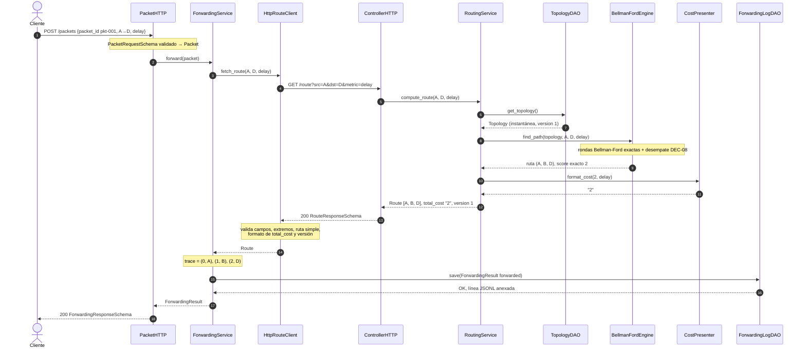
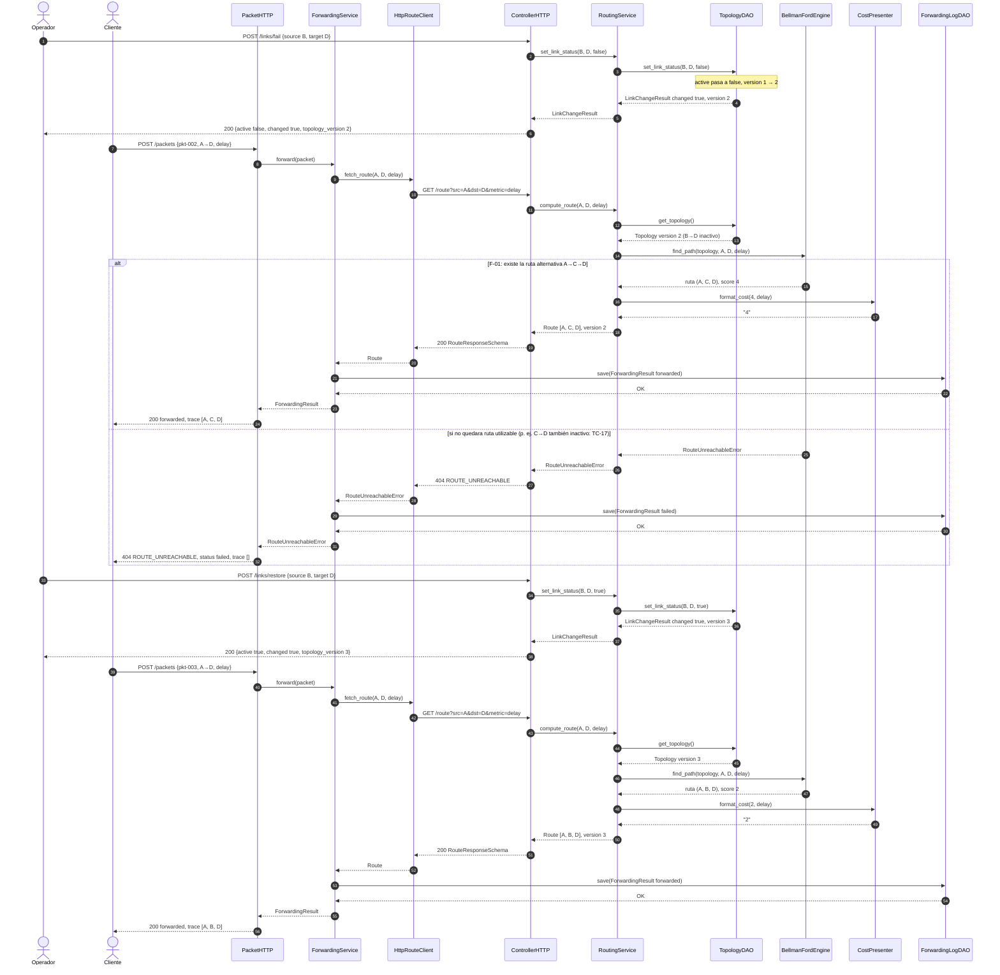
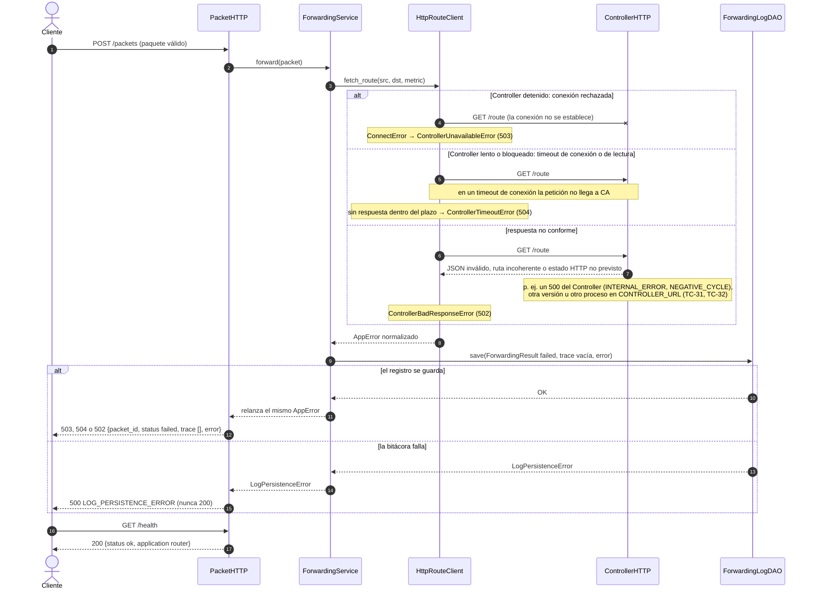

# 03 — Arquitectura dinámica: tres diagramas de secuencia

| Campo | Valor |
|---|---|
| Versión | **1.0** (candidata a baseline `spec-1.0`) · 2026-10-29 |
| Estado de aprobación | Ver `REVIEW-AND-BASELINE.md` |
| Reglas | Todo participante es una clase de `02` §3 (las interfaces `TopologyDAO` y `ForwardingLogDAO` se muestran por su tipo; en ejecución son `JsonTopologyDAO` y `JsonlForwardingLogDAO`). Toda petición HTTP coincide con `04`. Las flechas `-->>` son respuestas o propagación de excepciones, no llamadas nuevas. |

Datos comunes: fixture F-01 de `06` (grafo dirigido A→B, B→D con `delay_ms=1`; A→C, C→D con `delay_ms=2`), versión inicial 1, métrica `delay`.

## Secuencia 1 — Reenvío exitoso de un paquete

**Precondiciones:** ambos procesos activos; F-01 cargado por `JsonTopologyDAO`; bitácora escribible.
**Resultado:** el Router responde 200 `forwarded` con la traza `[A, B, D]`, idéntica a la ruta elegida por el Controller, después de registrar el resultado.

**Verificaciones:** el Router no ejecuta ningún algoritmo de rutas (TC-05); `trace[i].node == path[i]` (TC-06); `save` ocurre antes de la respuesta 200 (TC-06, TC-09); `RoutingService` pide una sola instantánea y llama una vez a `CostPresenter` (TC-08).

## Secuencia 2 — Fallo de enlace, nueva consulta y restauración

**Precondiciones:** F-01 recién cargado (versión 1); ruta inicial `[A, B, D]` con costo 2.
**Resultado:** tras fallar B→D, el siguiente paquete usa `[A, C, D]` con costo 4 (o, en una topología sin alternativa, recibe 404 `ROUTE_UNREACHABLE`); tras restaurar B→D vuelve a `[A, B, D]`. `topology_version` pasa de 1 a 2 y a 3.

**Reglas:** en modo dirigido, fallar B→D no afecta a D→B. El Router no recuerda rutas: cada paquete genera una consulta nueva y observa el estado vigente (DEC-06). Repetir el fallo o la restauración devuelve 200 con `changed=false` sin cambiar la versión (DEC-04). Un enlace con `p=1` sigue excluido aunque se restaure (DEC-02). Pruebas: TC-03, TC-04, TC-17, TC-18.

## Secuencia 3 — Controller no disponible, lento o incoherente

**Precondiciones:** Router activo; Controller detenido, lento o con respuesta no conforme; timeouts `CONTROLLER_CONNECT_TIMEOUT_SECONDS` y `CONTROLLER_READ_TIMEOUT_SECONDS` configurados (`02` §7).
**Resultado:** el Router responde un error estable y documentado (503, 504 o 502; 500 si además falla la bitácora), registra el resultado `failed` y sigue vivo.

**Modelo de fallos:** `HttpRouteClient` convierte cada fallo de red (todo `httpx.TransportError`, incluida una conexión cortada a mitad de respuesta, que se trata como respuesta no conforme) en una subclase de `AppError`; `ForwardingService.forward` guarda un `ForwardingResult` con `packet_id`, `source`, `destination`, `metric`, `status="failed"`, `trace=()`, `route=None`, `topology_version=None` y `error`, y relanza **la misma** excepción; `router/http_errors.py` la traduce a `PacketErrorSchema` con el estado HTTP que su tabla asigna al `error.code` (las excepciones no llevan estado HTTP). El Router no reintenta, no usa caché y no calcula rutas (DEC-06). `GET /health` informa la vida del proceso, no la del Controller. Las respuestas no exponen la excepción original ni la dirección del Controller. Pruebas: TC-07, TC-31, TC-32, TC-33.

## Matriz de consistencia secuencia → métodos → endpoints → pruebas

| Secuencia | Métodos (declarados en `02` §3) | Endpoints (`04`) | Requisitos | Pruebas |
|---|---|---|---|---|
| S1 | `PacketHTTP.post_packet`, `ForwardingService.forward`, `HttpRouteClient.fetch_route`, `ControllerHTTP.get_route`, `RoutingService.compute_route`, `TopologyDAO.get_topology`, `BellmanFordEngine.find_path`, `CostPresenter.format_cost`, `ForwardingLogDAO.save` | `POST /packets`, `GET /route` | FR-01, FR-03, FR-05, FR-07, FR-08, FR-10 | TC-01, TC-05, TC-06, TC-08, TC-09 |
| S2 | `ControllerHTTP.fail_link`, `ControllerHTTP.restore_link`, `RoutingService.set_link_status`, `TopologyDAO.set_link_status` y los métodos de S1 | `POST /links/fail`, `POST /links/restore`, `GET /route`, `POST /packets` | FR-06, FR-07, FR-09 | TC-03, TC-04, TC-17, TC-18 |
| S3 | `PacketHTTP.post_packet`, `PacketHTTP.health`, `ForwardingService.forward`, `HttpRouteClient.fetch_route`, `ForwardingLogDAO.save` | `POST /packets`, `GET /route`, `GET /health` | FR-07, FR-09, FR-10, NFR-06 | TC-07, TC-31, TC-32, TC-33 |

**Concurrencia:** `get_topology()` devuelve una instantánea inmutable; el DAO protege su estado y su versión con un candado de proceso, de modo que una consulta nunca mezcla dos versiones. No se garantiza consistencia entre varias instancias del Controller (fuera de alcance).
